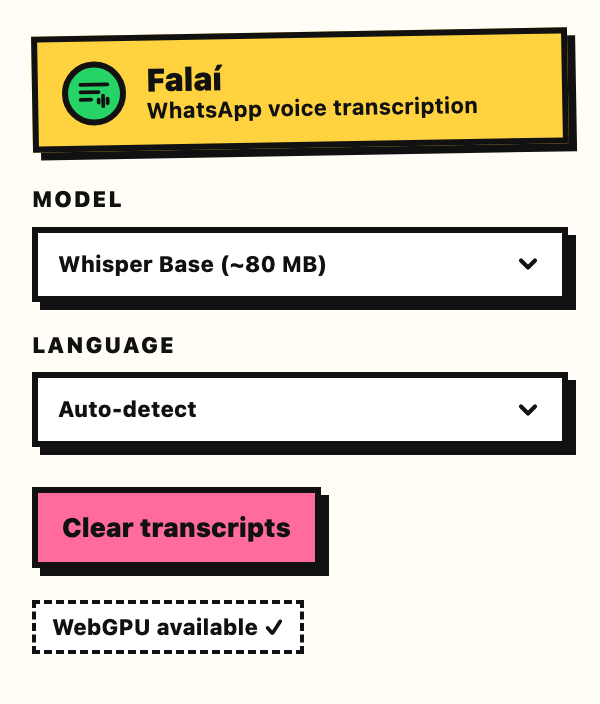
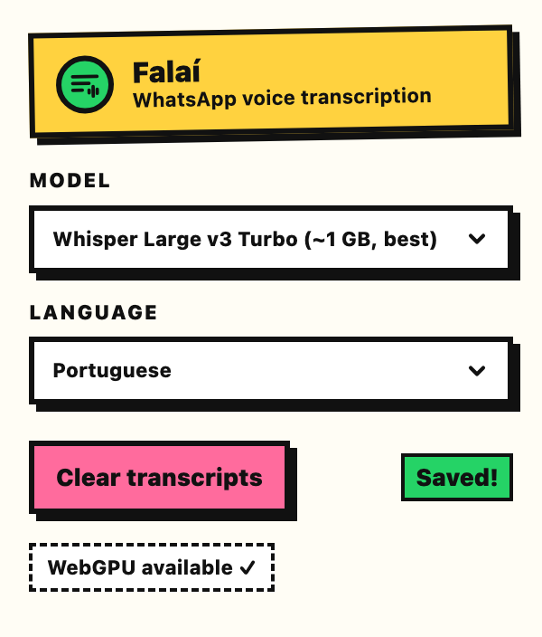
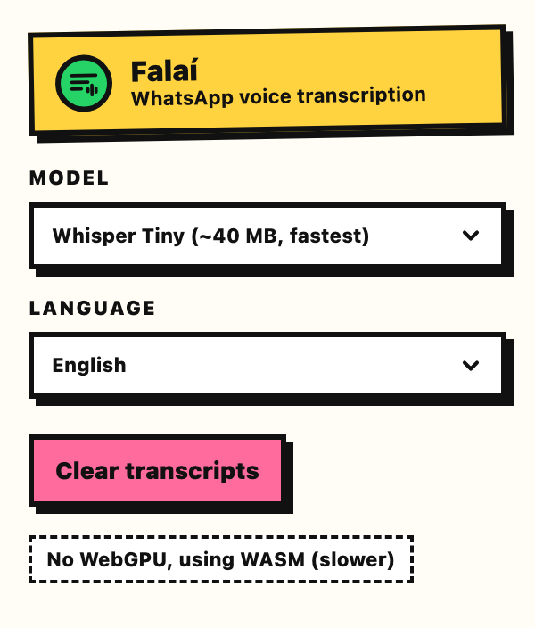

<p align="center"></p>

<h1 align="center">Falaí</h1>

## What and How?

Chrome extension that adds a transcribe button beside WhatsApp Web voice messages. Transcription runs locally with Whisper ([transformers.js](https://github.com/huggingface/transformers.js) on WebGPU, falling back to WASM), using the same setup as [Xenova/realtime-whisper-webgpu](https://huggingface.co/spaces/Xenova/realtime-whisper-webgpu).

<p align="center">
  
  
  
</p>

The popup sets the Whisper model and the language (or auto-detects it), and shows whether WebGPU is available.

## Why?

I don't really trust other solutions and wanted to build one myself from a project I stumbled upon on Hugging Face.

## Build

```bash
bun install
bun run build      # outputs dist/
bun run dev        # rebuilds on change
```

Then go to `chrome://extensions`, turn on Developer mode, click **Load unpacked** and pick `dist/`.

## How it works

| File                | Runs in                    | Role                                                                                                                                                                                   |
| ------------------- | -------------------------- | -------------------------------------------------------------------------------------------------------------------------------------------------------------------------------------- |
| `src/page-hook.ts`  | WhatsApp page (MAIN world) | Hooks `URL.createObjectURL` and `HTMLMediaElement.play`. When armed, the next `play()` hands back the decrypted audio Blob and stops playback silently.                                |
| `src/content.ts`    | Content script             | Adds the button beside each voice message, clicks play to capture the audio, sends it off, and renders the transcript. Transcripts are cached in `chrome.storage.local` by message id. |
| `src/background.ts` | Service worker             | Creates the offscreen document and routes progress back to the tab.                                                                                                                    |
| `src/offscreen.ts`  | Offscreen document         | Decodes the audio to 16 kHz mono and passes it to the worker.                                                                                                                          |
| `src/worker.ts`     | Web worker                 | Whisper pipeline: WebGPU, fp32 encoder + q4 decoder, 30 s chunking, and automatic language detection.                                                                                  |
| `src/popup.ts`      | Toolbar popup              | Model and language settings.                                                                                                                                                           |

Models are downloaded from Hugging Face the first time they are used, then cached.

## Credits

- [Xenova/realtime-whisper-webgpu](https://huggingface.co/spaces/Xenova/realtime-whisper-webgpu) by [Xenova](https://huggingface.co/Xenova): the Hugging Face Space this project is based on. The transcription setup in `src/worker.ts` (WebGPU, `onnx-community/whisper-base`, fp32 encoder + q4 decoder) follows it.
- [transformers.js](https://github.com/huggingface/transformers.js) and [ONNX Runtime Web](https://onnxruntime.ai/): run the model in the browser.
- [Whisper](https://github.com/openai/whisper) by OpenAI, with ONNX exports from [onnx-community](https://huggingface.co/onnx-community).
